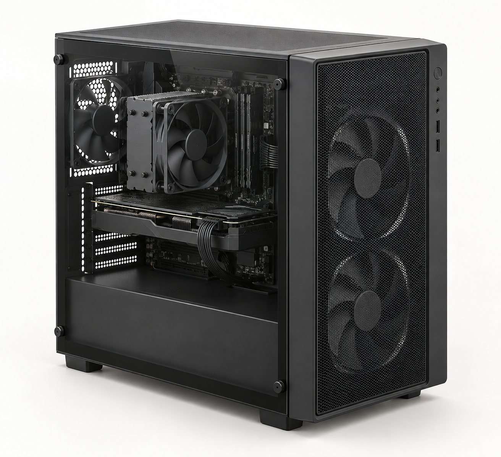
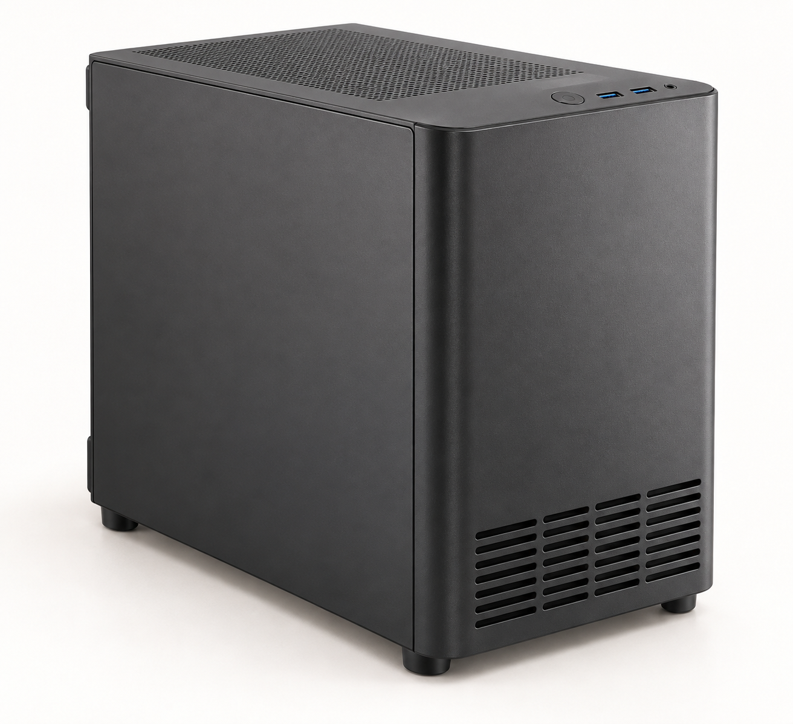
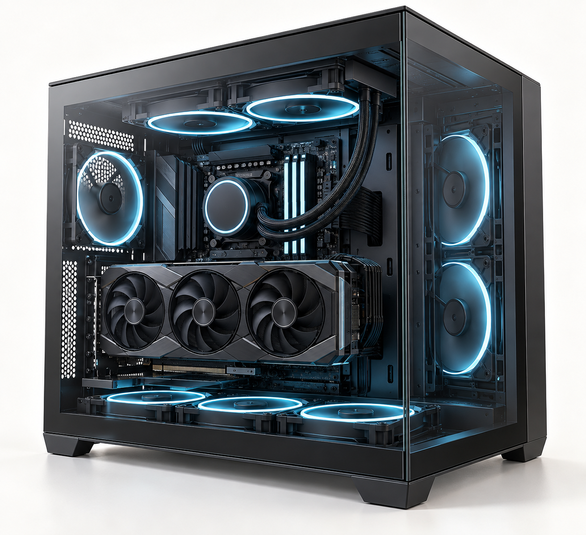
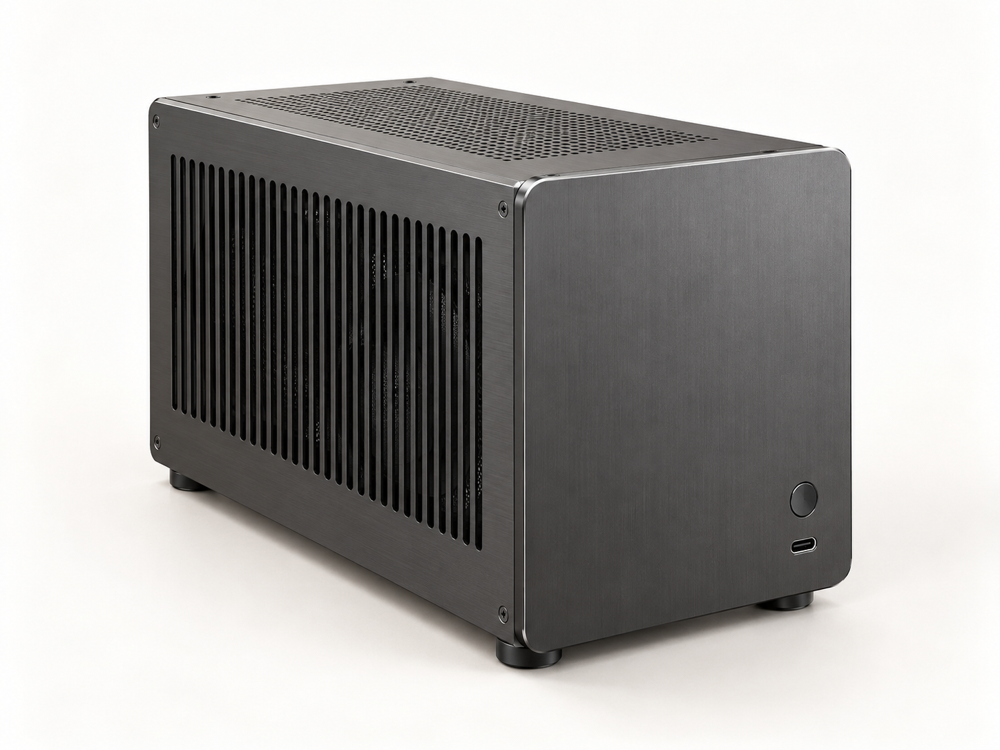
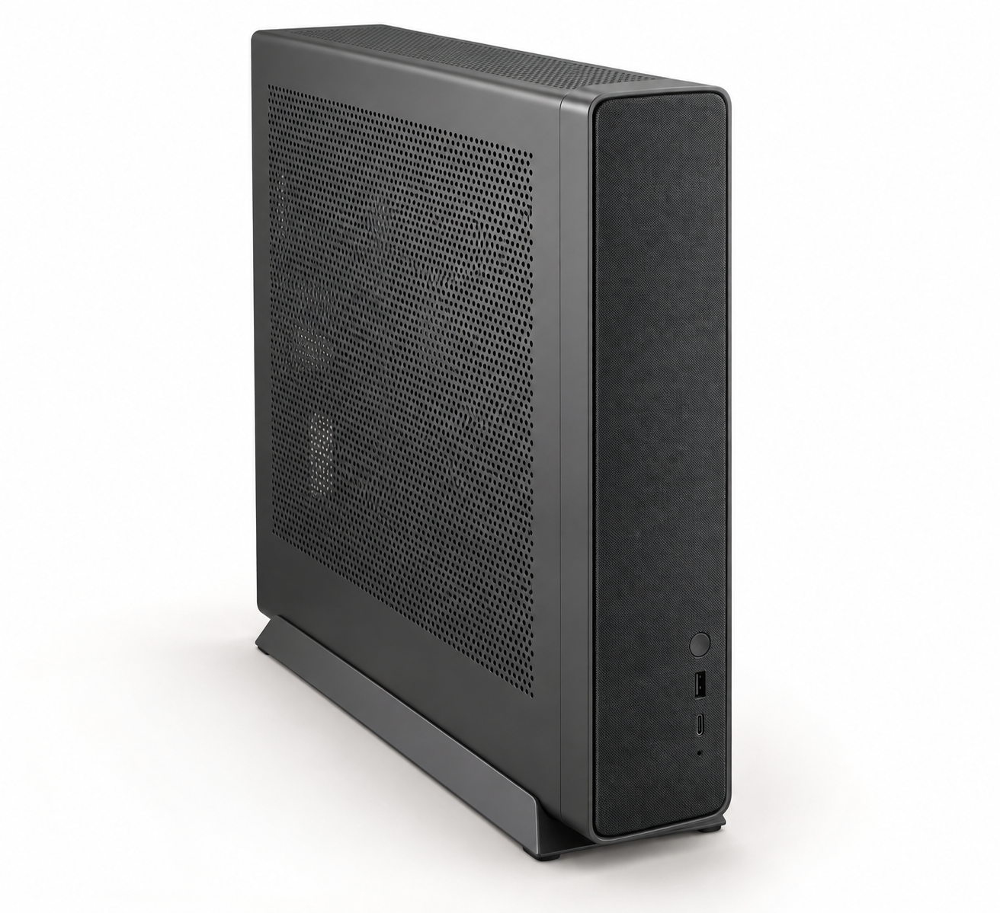
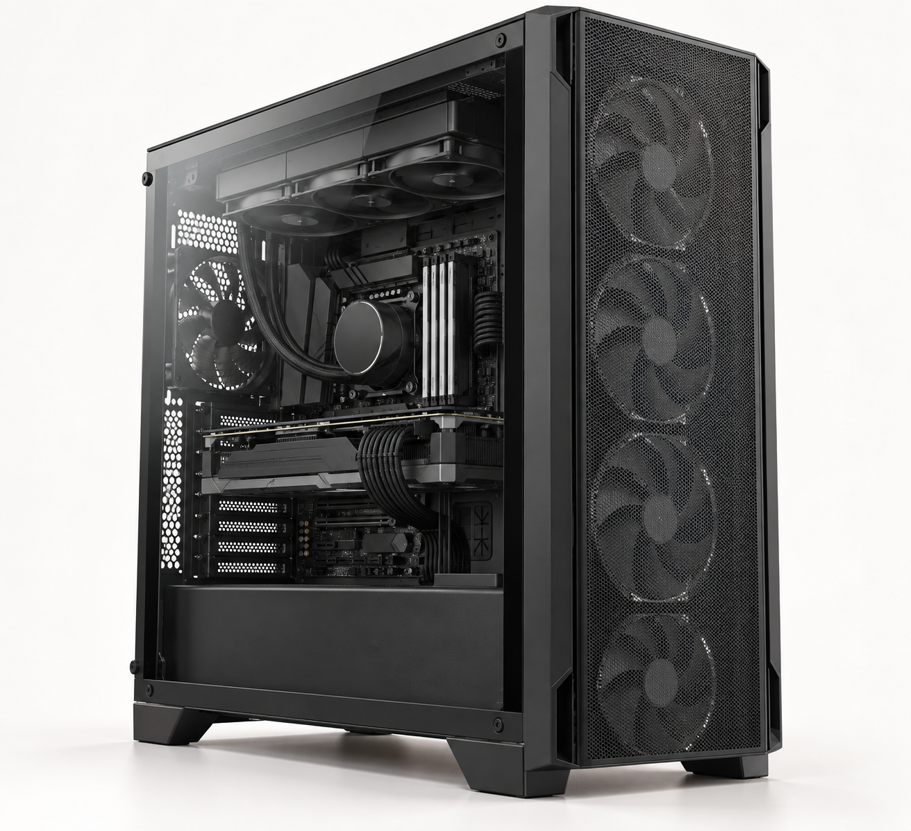

# Phân chia model ngoại hình PC SmartCare

Ngày tạo: 03/10/2026. Bộ gồm 6 ảnh concept để chọn hướng thiết kế ngoại hình cho app tư vấn build PC.

## Mục đích và phạm vi

Sáu nhóm này là cách tổ chức thư viện ngoại hình của PC SmartCare, giúp người không rành công nghệ chọn dáng máy theo sở thích và chỗ đặt máy. Đây là phân nhóm đề xuất cho sản phẩm, không phải hệ phân loại chính thức hoặc danh sách bao phủ mọi kiểu case trên thị trường.

Các nhóm cố ý có phần giao nhau: “showcase” mô tả cách trưng bày linh kiện, trong khi “compact” và “full tower” mô tả kích thước tổng thể. Ví dụ, một case nhỏ vẫn có thể dùng kính kiểu bể cá. Trong app, chọn dáng chủ đạo rồi bổ sung các thuộc tính như kích thước, vật liệu và màu sắc sẽ dễ hiểu hơn việc tạo một nhóm mới cho mỗi tổ hợp.

Ảnh là minh họa do AI tạo, chưa phải model 3D, bản vẽ kỹ thuật hoặc cấu hình đã kiểm tra tương thích. Chi tiết linh kiện, vị trí lắp, tỷ lệ và đường dây trong ảnh cần được thiết kế và kiểm tra lại khi dựng model thực tế.

## Tên model và ảnh tương ứng

| STT | ID đề xuất | Tên hiển thị | File ảnh | Điểm nhận diện |
| --- | --- | --- | --- | --- |
| 01 | `standard_tower` | Tower tiêu chuẩn | [01_standard_tower.png](01_standard_tower.png) | Dáng tháp vừa, mặt trước thông gió, bố cục phổ thông |
| 02 | `compact_tower` | Tower nhỏ gọn | [02_compact_tower.png](02_compact_tower.png) | Tháp thấp và gọn hơn, vẫn giữ dáng PC truyền thống |
| 03 | `showcase_dual_chamber` | Showcase / Bể cá | [03_showcase_dual_chamber.png](03_showcase_dual_chamber.png) | Kính trước và bên hông, thân rộng, hai khoang |
| 04 | `mini_sff` | Mini / SFF dạng hộp | [04_mini_sff.png](04_mini_sff.png) | Hộp nhỏ, ưu tiên tiết kiệm không gian |
| 05 | `slim_console` | Slim / Kiểu console | [05_slim_console.png](05_slim_console.png) | Thân mỏng, có thể thiết kế chân đứng hoặc đặt ngang |
| 06 | `full_tower` | Tower lớn | [06_full_tower.png](06_full_tower.png) | Tháp cao, sâu, nhiều không gian cho linh kiện và tản nhiệt |

ID và tên file là quy ước đề xuất cho bộ concept này, chưa được thêm vào dữ liệu hoặc giao diện của app.

## Đặc điểm từng nhóm

### 01 — Tower tiêu chuẩn

Dáng máy tháp cỡ vừa, dễ nhận ra và dùng làm mẫu nền cho thư viện. Ảnh dùng mặt trước dạng lưới và hông kính để thấy bố cục bên trong. Khi triển khai có thể thêm hông kín, màu trắng hoặc đèn RGB mà vẫn giữ cùng nhóm ngoại hình.

Phù hợp với bối cảnh người dùng có vị trí đặt máy thông thường và muốn cân bằng giữa kích thước, khả năng mở rộng và cách lắp ráp dễ theo dõi. Không gian thực tế phải được xác định bằng số đo của model.

### 02 — Tower nhỏ gọn

Dáng tháp thấp và gọn hơn mẫu tiêu chuẩn. Điểm khác biệt với Mini / SFF là vẫn giữ bố cục tháp truyền thống; phiên bản tham chiếu hướng tới mainboard micro-ATX.

Phù hợp với bàn nhỏ hoặc người muốn bộ máy gọn nhưng vẫn thích hình dáng PC quen thuộc. Khi dựng cần kiểm tra chỗ cho GPU, tản CPU, nguồn và dây, thay vì chỉ thu nhỏ model Tower tiêu chuẩn.

### 03 — Showcase / Bể cá

Ưu tiên nhìn thấy linh kiện qua kính phía trước và bên hông. Bản concept dùng bố cục hai khoang: khoang trưng bày linh kiện và khoang chứa nguồn, dây. Thân thường rộng hơn dáng tháp truyền thống có chiều cao tương tự.

Phù hợp với người muốn bộ PC trở thành một phần trang trí trên bàn. RGB là tùy chọn; phiên bản không đèn vẫn thuộc nhóm Showcase. Kính, vị trí quạt và đường hút/xả khí cần được cân nhắc cùng nhau khi thiết kế.

### 04 — Mini / SFF dạng hộp

Dáng hộp rất gọn, bản concept hướng tới mainboard mini-ITX và nguồn SFX. Có thể dùng bố cục riêng như đặt GPU ở khoang đối diện mainboard, tùy thiết kế.

Phù hợp với không gian hẹp hoặc người ưu tiên máy nhỏ. SFF không đồng nghĩa với cấu hình yếu, nhưng không gian hạn chế khiến việc chọn linh kiện, tản nhiệt và đi dây cần kiểm tra kỹ hơn.

### 05 — Slim / Kiểu console

Thân mỏng, dáng giống thiết bị console. Ảnh thể hiện cách đặt đứng trên chân đế; nếu muốn hỗ trợ đặt ngang, cần thiết kế thêm chân đỡ và bảo đảm các cửa thông gió không bị che.

Phù hợp với người muốn đặt máy ở vị trí hẹp hoặc trong khu vực giải trí. Đây cũng có thể là một kiểu SFF, nhưng được tách thành lựa chọn riêng trong app vì hình dáng và cách đặt khác rõ rệt so với hộp Mini.

### 06 — Tower lớn

Dáng tháp cao và sâu hơn mẫu tiêu chuẩn, tạo khoảng trống cho nhiều linh kiện, ổ lưu trữ hoặc hệ tản nhiệt lớn. Ảnh minh họa dùng nhiều quạt mặt trước và két tản phía trên.

Phù hợp với người có đủ chỗ đặt máy và cần mở rộng. Case lớn không tự quyết định hiệu năng hoặc độ mát; kết quả còn phụ thuộc linh kiện, luồng gió và cách lắp.

## Tách ngoại hình khỏi nhu cầu sử dụng

App hiện có 4 nhóm nhu cầu trong `src/data/builds.ts`: Văn phòng, Học tập, Gaming và Đồ họa. Sáu nhóm ở tài liệu này thuộc lớp ngoại hình. Một kiểu ngoại hình có thể phục vụ nhiều nhu cầu nếu linh kiện phù hợp và lắp vừa.

Ví dụ: người chơi game có thể chọn Tower tiêu chuẩn, Showcase hoặc Mini / SFF. Người làm việc văn phòng vẫn có thể chọn Showcase vì thích kính và đèn. Không nên gán cố định “Gaming = Bể cá” hay “Văn phòng = Mini”.

Luồng chọn đề xuất:

1. Nhập nhu cầu sử dụng và ngân sách.
2. Xác định chỗ đặt máy, kích thước tối đa và tư thế đứng/ngang.
3. Chọn kiểu ngoại hình trong các lựa chọn đáp ứng giới hạn không gian và cấu hình.
4. Chọn màu, vật liệu vỏ và đèn.
5. Kiểm tra tương thích linh kiện và hiển thị cấu hình hoàn chỉnh.

## Biến thể trong cùng một nhóm

| Thuộc tính | Ví dụ lựa chọn | Cách áp dụng |
| --- | --- | --- |
| Màu sắc | Đen, trắng, xám | Biến thể màu của cùng thiết kế |
| Vỏ và cửa sổ | Hông kín, lưới, kính khói, kính trong | Chỉ cung cấp lựa chọn mà cấu trúc case hỗ trợ |
| Ánh sáng | Không đèn, một màu, RGB | Có thể dùng chung model vỏ, thay vật liệu hoặc linh kiện có đèn |
| Chi tiết trang trí | Nhôm xước, điểm nhấn gỗ | Biến thể vật liệu hoặc chi tiết bề mặt |
| Tản nhiệt | Tản khí, AIO, custom loop | Thuộc cấu hình bên trong; cần kiểm tra chỗ lắp |

Không cần tạo một nhóm ngoại hình mới cho mỗi màu, hiệu ứng đèn hoặc nhu cầu sử dụng. Những thay đổi lớn về cấu trúc và bố trí linh kiện có thể cần model 3D riêng dù vẫn nằm trong cùng nhóm.

## Giới hạn và hướng triển khai

Sáu nhóm là bộ khởi đầu để người dùng so sánh các dáng máy khác nhau. Những thiết kế đặc biệt như open-frame, treo tường, case tích hợp bàn hoặc vỏ tùy biến có thể được thêm khi có nhu cầu; không cần khẳng định bộ này bao phủ toàn bộ thị trường.

Nếu chia giai đoạn, đề xuất làm trước Tower tiêu chuẩn, Tower nhỏ gọn, Showcase và Mini / SFF, sau đó bổ sung Slim và Tower lớn. Bộ Gaming hiện có có thể làm điểm xuất phát để đối chiếu với Tower tiêu chuẩn, nhưng cần kiểm tra thiết kế thực tế trước khi tái sử dụng.

Bộ ảnh được giữ cùng tông màu và góc chụp để dễ so sánh dáng máy. Khi dựng 3D, mỗi model cần có số đo, vị trí mainboard/nguồn/GPU, giới hạn tản nhiệt và đường dây riêng. Tài liệu này ghi hướng thiết kế; chưa yêu cầu thay đổi 4 cấu hình đang có trong app.
